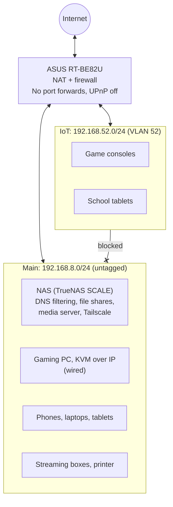

# Home Network Segmentation

Segmenting my home network: an isolated IoT subnet, the firewall policy that enforces it, packet-capture verification, and a write-up on diagnosing failed remote access to my media server.

## Goal

Split my home network so that IoT devices (game consoles and school tablets)
can reach the internet but not my NAS or personal computers. This repo
documents the design, the firewall policy that enforces it, how I tested
that the isolation works, and how I diagnosed why remote access to my media
server was failing.

## Network diagram



Remote access to the NAS goes through Tailscale, which connects outbound from the NAS. Nothing on the router accepts inbound connections.

## Segments

| Segment | Subnet | VLAN | Devices | DNS | Can reach |
| --- | --- | --- | --- | --- | --- |
| Main | 192.168.8.0/24 | Untagged | NAS, wired PCs, KVM, personal phones, laptops, and tablets, streaming boxes, printer | AdGuard Home on the NAS | Everything |
| IoT | 192.168.52.0/24 | 52 | Game consoles, school tablets | The router (192.168.52.1), which forwards to the ISP | Internet only |
| Guest | Not built yet | | | | |

**Why some devices stay on Main**

- **Wired devices:** this router has no per-port VLAN setting, so every wired port is on Main. That's fine, since everything wired (NAS, gaming PC, KVM) belongs there.
- **Streaming boxes:** they stream from the media server on the NAS, and isolation blocks IoT from the NAS.
- **Printer:** AirPrint finds printers with mDNS (multicast DNS, also called Bonjour), and mDNS announcements don't cross from one subnet to another. On IoT, the printer would vanish from everyone's print menu.
- **The KVM over IP:** it controls a computer, so it never goes on a less trusted segment.

## Firewall rules

The router's Firewall page only controls traffic arriving from the internet. It has no page for rules between internal segments, so the IoT policy comes from the network's own settings (separate subnet plus AP isolation). This table is the effective policy: what the router actually allows, confirmed by testing where noted.

| From | To | Result | Enforced by | Tested |
| --- | --- | --- | --- | --- |
| Main | Internet | Allowed | NAT | Yes |
| IoT | Internet | Allowed | NAT | Yes (ping by IP, DNS lookup) |
| IoT | Router DNS (192.168.52.1, port 53) | Allowed | Router serves DNS on the IoT subnet | Yes |
| IoT | Main (any device, any port) | Blocked, silently dropped | Separate subnet on VLAN 52 | Yes (ping and SMB both timed out) |
| IoT | Other IoT devices | Blocked | AP isolation | No |
| Main | IoT | Unknown | | Not yet |
| Internet | Any device (IPv4) | Blocked | NAT, no port forwards, UPnP off, empty inbound rule table | Yes (see CGNAT write-up) |
| Internet | Any device (IPv6) | Blocked | IPv6 firewall on, no allow rules | No |

**Why IPv6 matters here:** IPv6 has enough addresses that home routers don't use NAT, so each device can have a globally reachable address. Without NAT hiding them, the IPv6 firewall is the only thing blocking inbound connections.

## Verification

**Method:** the same MacBook ran the same tests from the old IoT Wi-Fi, from the rebuilt IoT network, and from Main. On the NAS, a packet capture ran the whole time to record what actually arrived.

| Test | Old IoT Wi-Fi | Rebuilt IoT (VLAN 52) | Main (control) |
| --- | --- | --- | --- |
| Address from DHCP | 192.168.8.158 | 192.168.52.189 | 192.168.8.175 |
| DNS server handed out | 192.168.8.210 (the NAS) | 192.168.52.1 (the router) | 192.168.8.210 (the NAS) |
| Ping the NAS | 4 of 4 replies, TTL 64 | 0 of 4, 100% loss | 4 of 4 replies, TTL 64 |
| Connect to SMB (TCP 445) on the NAS | Succeeded | Timed out | |
| Ping 1.1.1.1 | | 2 of 2 replies | |
| DNS lookup | | Resolved | |

Commands used on the Mac:

```bash
ipconfig getifaddr en0                                   # the Mac's address
ipconfig getpacket en0 | grep -E "router|domain_name_server"   # gateway and DNS from DHCP
ping -c 4 192.168.8.210                                  # reach the NAS?
nc -vz -G 3 192.168.8.210 445                            # SMB port open from here?
ping -c 2 1.1.1.1                                        # internet by IP
dig google.com +short +time=2 +tries=1                   # DNS works?
```

Capture on the NAS:

```bash
sudo sh -c 'nohup timeout 600 tcpdump -lni enp6s0 icmp > /tmp/tcpdump-after.txt 2>&1 &'
```

During the IoT test window, the capture recorded **no packets from 192.168.52.0/24**. A minute later, from Main, every ping arrived and got a reply:

```
00:07:28.784798 IP 192.168.8.175 > 192.168.8.210: ICMP echo request, id 56360, seq 0, length 64
00:07:28.784849 IP 192.168.8.210 > 192.168.8.175: ICMP echo reply, id 56360, seq 0, length 64
00:07:29.790707 IP 192.168.8.175 > 192.168.8.210: ICMP echo request, id 56360, seq 1, length 64
00:07:29.790747 IP 192.168.8.210 > 192.168.8.175: ICMP echo reply, id 56360, seq 1, length 64
```

**What the results show**

- **TTL 64 on the old network means no router in between.** Every router a packet crosses subtracts 1 from its TTL (time to live), and Linux starts at 64. Replies arriving at 64 meant the "IoT" Wi-Fi and the NAS were on the same network.
- **The rebuilt network drops traffic silently.** The SMB test timed out rather than being refused, so nothing answered at all. A device on IoT can't even learn that the NAS exists.
- **The pings never reached the NAS.** The capture shows nothing arrived from the IoT subnet, so the traffic was stopped before it got to the NAS, not ignored by it.
- **The capture also showed UPnP being refused.** Throughout the capture, the router answered "port unreachable" to port-mapping requests from the NAS on UDP 5351 (NAT-PMP/PCP) and 1900 (UPnP), so nothing on the network can open an inbound port automatically.

## Troubleshooting: was I really behind CGNAT?

**Background:** About a year ago I made my media server reachable from
outside the house. I first routed it through Cloudflare's proxy on my own
domain, until I learned Cloudflare's terms restrict serving video through
its proxy unless you're on an Enterprise plan or use its paid video
products. I then switched to dynamic DNS and a port forward on my router.
Within about a month, the traffic stats showed constant scanning from
across the internet, so I removed the port forward and moved remote access
to Tailscale.

**Symptom:** In October 2026 I turned on the media server's built-in
remote access, and it failed. I had forgotten removing the port forward
and assumed my ISP used carrier-grade NAT (CGNAT), which blocks all
inbound connections.

**Hypothesis:** If I'm behind CGNAT, my router's WAN address will fall in
the shared range 100.64.0.0/10, and the internet will see a different
address than my router has.

**Tests and evidence:**

1. **Routing table.** The router's WAN interface sits in a public /23
   subnet, not in 100.64.0.0/10.
2. **Traceroute to 1.1.1.1.** The hop after my router is an ordinary
   public ISP address. Behind CGNAT, I'd expect a 100.64.x.x hop there.

```
    1  router (192.168.8.1)        4.392 ms
    2  [ISP router, public IP]     15.893 ms
    3  [ISP core router]           23.639 ms
```

3. **External IP check.** `curl -4 ifconfig.me` returned an address
   inside my router's WAN subnet, so the internet sees my router's own
   address.

**Conclusion:** I'm not behind CGNAT. My ISP gives the router a public
IPv4 address.

**Cause:** UPnP is disabled, and the port forward I removed a year
earlier is gone, so the router drops inbound connections. From the
outside, that looks the same as CGNAT.

**Resolution:** Everything stays closed. Remote access runs through
Tailscale. See the port forwarding decision under Decisions and
trade-offs.

**Note:** The public address is dynamic and can change, which matters for
connecting by raw IP address but isn't what caused this failure.

## Decisions and trade-offs

**No port forwarding for remote media access.** My ISP gives me a public
IP, so a port forward works, and I ran one for about a month. In that
time the server attracted constant scanning from across the internet,
far beyond my one remote viewer. Any flaw in the media server would have
been exposed to all of it. I removed the forward and use Tailscale
instead, which reaches the server through an encrypted tunnel without
opening any inbound ports. UPnP stays disabled so no device can open
ports on its own.

**Router DNS for IoT, no filtering.** The NAS's DNS filtering isn't reachable from IoT, so IoT devices use the router's resolver, which forwards to the ISP. Keeping isolation complete mattered more than filtering for game consoles and school tablets. Opening port 53 to the NAS would mean a per-port exception, and this router doesn't support one.

**AP isolation on IoT.** Devices on IoT can't reach each other, so one compromised device can't attack the rest. The cost is that two consoles can't find each other through the router. Console-to-console local play uses a direct wireless link and doesn't go through the router, so it's unaffected.

**Removed an unused guest network.** A leftover guest network from when a relative lived with us was turned off but still configured. I deleted it, since unused access paths are better removed than left disabled.

## What broke

**The existing IoT Wi-Fi wasn't isolated.** I already had an IoT network on the router and assumed it was separate. Testing showed it handed out main-subnet addresses and the NAS as DNS, and a device on it could reach the NAS's file shares. The cause was the router's "Use same subnet as main network" option, which is on by default when you create an IoT network. That setting can't be changed on an existing network, so I deleted it and recreated it with the same name and password (so devices rejoined on their own), this time on its own subnet and VLAN.

**My test cut off my own monitoring.** I watched the capture from the NAS's web shell on the same laptop I was testing with. When the laptop joined the isolated network, it lost access to the NAS web page, and the shell went with it. I fixed this by running tcpdump in the background with `nohup` (keeps it running after the shell disconnects) and `timeout` (stops it after 10 minutes), writing to a file I read after the laptop returned to Main.

## What I'd improve

- **A dedicated firewall.** A router running OPNsense or pfSense would allow per-port rules between segments. For example, IoT could reach only DNS on the NAS and nothing else, instead of an all-or-nothing block.
- **An mDNS reflector**, so the printer and streaming boxes could move to IoT while Main devices still find them. A reflector repeats mDNS announcements from one subnet to another.
- **A managed switch** for wired VLANs, so wired devices could be segmented too.
- **Central Wi-Fi.** Run the ASUS in access point mode (Wi-Fi only, no routing) from a central room, cabled back to the new firewall. Before buying, I'd confirm the ASUS can keep separate Wi-Fi networks on VLAN tags in AP mode; otherwise the IoT separation would be lost.
- **Filtered DNS on IoT.** IoT lookups currently go unfiltered to the ISP's resolver. With per-port rules, IoT could use the NAS's DNS filtering without reaching anything else on the NAS.
- **Finish testing:** traffic from Main into IoT, AP isolation between IoT devices, and the IPv6 inbound block.
- **A guest network** in the router's remaining network slot.
